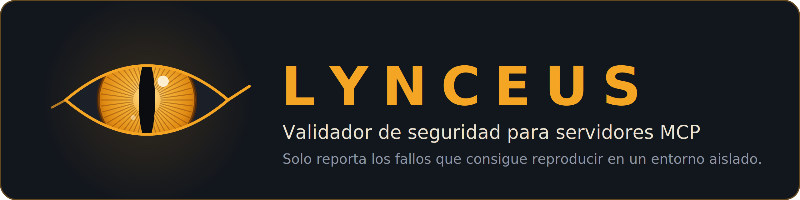
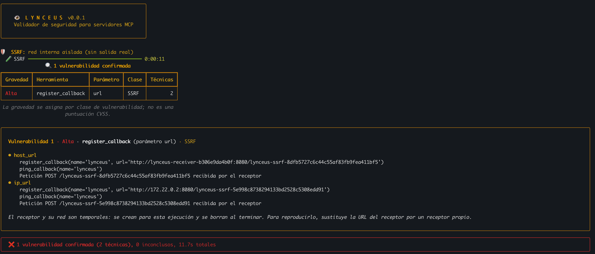
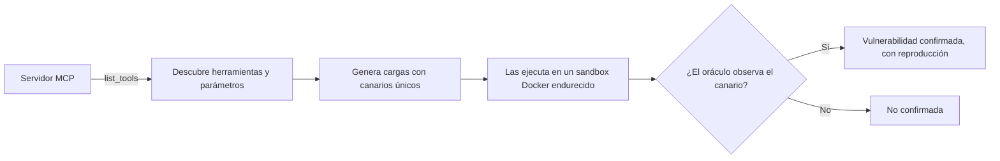

<p align="center">
  
</p>

<p align="center">
  
  
  
</p>

Lynceus analiza servidores MCP (Model Context Protocol) y **solo reporta los fallos de implementación que consigue reproducir** dentro de un sandbox aislado, con la evidencia y la llamada exacta que los reproduce.

> **Estado:** en desarrollo (v0.0.1). Se instala desde el código fuente; no está publicado en PyPI.

<p align="center">
  
</p>

## Por qué

Los servidores MCP exponen herramientas que un agente de IA invoca con parámetros que pueden venir de contenido no confiable: una página web, un documento o una inyección de prompt. Si una herramienta usa esos parámetros en un comando, una ruta de fichero o una URL sin validarlos, el atacante controla el servidor.

- De 524 CVE únicos relacionados con MCP en NVD (25/10/2026), las clases más frecuentes son inyección de comandos (21 %), autenticación y origen (18 %), SSRF (17 %), autorización (11 %) y path traversal (10 %).
- Los analizadores estáticos generalistas no tratan los parámetros de las herramientas MCP como entrada no confiable: CodeQL no detectó ninguno de los casos vulnerables iniciales del benchmark.
- Las reglas estáticas que sí lo hacen generan falsos positivos cuando no entienden la validación. Un canario que no se activa los descarta.

## Cómo funciona



| Clase | Canario | Oráculo |
|---|---|---|
| Inyección de comandos | Fichero con nombre aleatorio que solo crea un comando inyectado | El fichero existe tras la llamada |
| Path traversal | Fichero fuera del directorio permitido, con contenido aleatorio | El contenido aparece en la respuesta |
| SSRF | Receptor HTTP en una red interna sin salida | El receptor recibe la petición con el token del intento |

Las herramientas y los parámetros se descubren con `list_tools`, como con cualquier servidor desconocido: nada está adaptado a casos concretos. Cada intento arranca un servidor nuevo, y en SSRF se prueban también flujos en dos pasos (una herramienta guarda la URL y otra la usa).

## Resultados

Benchmark propio de 24 casos (8 por clase, 4 vulnerables y 4 corregidos), comparando reglas taint de Semgrep con la validación dinámica:

| Clase | Reglas de Semgrep (precisión / recall) | Validación dinámica (precisión / recall) |
|---|---|---|
| Inyección de comandos | 1,00 / 0,25 | 1,00 / 0,75 |
| Path traversal | 0,75 / 0,75 | 1,00 / 1,00 |
| SSRF | 0,67 / 0,50 | 1,00 / 1,00 |
| **Global** | **0,75 / 0,50** | **1,00 / 0,92** |

El único falso negativo de la validación dinámica es un caso inconcluso por su entorno (`cmdi-03`). **Cautela:** los casos los escribió un agente de código y ya se han usado durante el desarrollo, así que estas cifras no son una medida independiente. El detalle, la metodología y las limitaciones están en [`docs/landscape.md`](docs/landscape.md).

## Inicio rápido

Requisitos: Python 3.12, [uv](https://docs.astral.sh/uv/) y Docker.

```bash
git clone https://github.com/acanellada/Lynceus.git
cd Lynceus
uv sync
docker build -t lynceus-sandbox:0.1 sandbox/
uv run lynceus scan benchmark/cases/ssrf-03-vulnerable --report informe.html
```

## Uso

### `lynceus scan`

Valida dinámicamente una carpeta con `server.py` (por ahora, el mismo formato que un caso del benchmark):

```bash
uv run lynceus scan ./mi-servidor-mcp
uv run lynceus scan ./mi-servidor-mcp --classes ssrf --classes path_traversal
uv run lynceus scan ./mi-servidor-mcp --json out.json --report out.html
```

### `lynceus bench`

Ejecuta la validación dinámica sobre `benchmark/cases` y muestra la precisión y el recall por clase y globales:

```bash
uv run lynceus bench
uv run lynceus bench --classes command_injection
```

### Opciones

| Opción | Comandos | Descripción |
|---|---|---|
| `--classes` | `scan`, `bench` | Clase a incluir (repetible): `command_injection`, `path_traversal`, `ssrf`. Por defecto, las tres. |
| `--json` | `scan` | Ruta donde escribir el informe en JSON (con `schema_version`). |
| `--report` | `scan` | Ruta donde escribir el informe HTML autónomo, sin JavaScript ni recursos externos. |
| `--plain` | `scan`, `bench` | Texto plano, sin colores ni emojis: estable para `grep` o CI. |

### Códigos de salida de `lynceus scan`

- `0`: validación completada, sin vulnerabilidades confirmadas.
- `1`: validación completada, con una o más vulnerabilidades confirmadas.
- `2`: error (argumentos o carpeta no válidos, o fallo del entorno de validación, por ejemplo, Docker no disponible).

El formato se desactiva solo si existe la variable `NO_COLOR` o si la salida no es una terminal interactiva (al redirigirla a un fichero o a una tubería).

## Seguridad del sandbox

El servidor analizado es código no confiable. Lynceus lo ejecuta siempre dentro de un contenedor con estas protecciones:

- Sin red (`--network none`), o en SSRF, una red Docker interna creada para cada caso y borrada al terminar. Antes de los intentos se comprueba que no hay salida TCP ni resolución DNS externa; si la hay, la validación se aborta.
- Sistema de ficheros de solo lectura, `/tmp` limitado a 16 MB y sin ejecución.
- Sin capacidades (`--cap-drop ALL`), `no-new-privileges` y usuario sin privilegios.
- Límites de procesos, memoria (sin swap) y CPU, y tiempo máximo por intento.
- El servidor y el harness montados en solo lectura; ningún puerto publicado hacia el host.
- Imagen base fijada por digest y dependencias fijadas con hash.
- Los informes tratan como no confiable todo texto que venga del servidor: se escapa en el HTML (que lleva además una política de seguridad de contenido sin scripts) y se limpia de secuencias de escape en la terminal.

El modelo de amenazas completo está en [`docs/threat-model.md`](docs/threat-model.md).

## Limitaciones

- El objetivo debe ser, por ahora, una carpeta con `server.py` que arranque por stdio, con las dependencias de la lista cerrada del sandbox (`mcp` y `requests`).
- Solo se prueban parámetros de tipo texto y tres clases de vulnerabilidad.
- En inyección de comandos y path traversal, el oráculo corre en el mismo contenedor que el servidor: un servidor malicioso podría fingir un positivo (nunca ocultar uno real). En SSRF, el oráculo es externo.
- Un servidor que bloquea las IP privadas bloquea también al receptor de SSRF, aunque su validación tenga un agujero.

## Hoja de ruta

- Probar Lynceus contra servidores MCP reales con CVE publicado, con instalación de dependencias en una fase de construcción separada de la ejecución.
- Un lote de casos nuevo, no usado durante el desarrollo, para una medida independiente.
- Salida SARIF y GitHub Action.
- Distribución como skill para agentes de código, cuando haya una versión estable.

El detalle está en [`docs/roadmap.md`](docs/roadmap.md).

## Documentación

- [`docs/landscape.md`](docs/landscape.md): herramientas existentes, líneas base (Bandit, Semgrep y CodeQL), datos de CVE y resultados.
- [`docs/threat-model.md`](docs/threat-model.md): modelo de amenazas, incluido el del propio sandbox.
- [`docs/roadmap.md`](docs/roadmap.md): hoja de ruta.
- [`benchmark/README.md`](benchmark/README.md): formato y criterios de etiquetado del benchmark.

## Uso responsable

Utiliza Lynceus solo contra servidores propios o con autorización expresa. Los casos del benchmark son vulnerables a propósito: no los expongas a una red ni los ejecutes fuera del sandbox.

## Licencia

[Apache-2.0](LICENSE).
